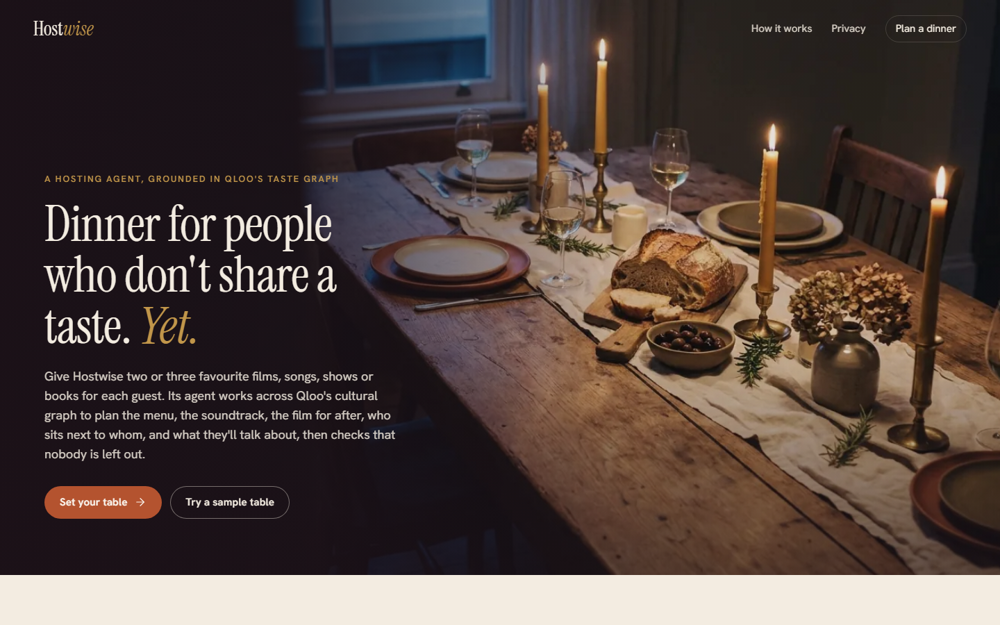

# Hostwise

**Dinner for people who don't share a taste. Yet.**

Hostwise is a hosting agent for mixed groups. Give it two to four favourite films, songs,
series, books, podcasts or games for each guest, and it plans the evening: who sits next to
whom, a menu, a soundtrack in three moods, a film short enough for after dinner, and
conversation cards. Every decision is grounded in [Qloo](https://www.qloo.com/)'s
cross-domain taste graph and shows its evidence.

Built by **Rui Codex** for the [Qloo Agentic Hackathon](https://qloo.devpost.com/).



## Why it needs Qloo

A language model alone will suggest "a crowd-pleasing film and some Italian food". It can't
tell you that the crowd-pleaser sits at the bottom of one guest's taste, which food
cultures a fan of *Spirited Away* and Ryuichi Sakamoto leans towards, or that two people at
your table quietly share a soft spot for funk. Hostwise can, because each step is a
measurement in Qloo's graph:

| Agent tool | Qloo endpoint | What it answers |
| --- | --- | --- |
| `resolve_favourite` | `GET /search` | Which Qloo entity is the favourite the host typed? |
| `pooled_recommendations` | `GET /v2/insights` with `feature.explainability` | What does the whole table lean towards, and whose favourites pulled each candidate in? |
| `rank_for_guest` | `GET /v2/insights` with `filter.entities` | How does each shortlisted option score against *one* guest's taste? |
| `personal_picks` | `GET /v2/insights` (one guest's signals) | What would the left-out guest love? Used to re-plan. |
| `cuisine_affinity` | `GET /v2/insights`, `filter.type=urn:tag`, `filter.tag.types=urn:tag:genre:place` | Which cuisines do a guest's films, music and books lean towards? |
| `shared_ground` | `GET /v2/analysis/compare` | What two guests share and where they differ. |

Without Qloo there is nothing to score, no fairness test, no seating and no cards. The app
does not fall back to an LLM when Qloo fails; the section is skipped and says so.

## How the agent works

`server/agent/planner.js` runs a goal-driven loop over those tools. For each goal
(soundtrack, film, menu, a shared daydream destination, seating):

1. **Pool** the whole table's favourites in one Qloo request for candidates.
2. **Score each guest alone**: the shortlist is ranked against every guest's own signals
   (`filter.entities`), and each guest's affinities are normalised across the pool.
3. **Critique** with a least-misery test: group score = 0.6 × weakest fit + 0.4 × mean fit;
   anyone under 35 % fit is "left out".
4. **Re-plan**: fetch picks from the left-out guest's side of the graph, re-score them for
   everyone, and keep whichever balances the table best. The menu does the same with a
   bridge starter from the left-out guest's cuisine. Hard constraints are checked too (films
   over 140 minutes are ruled out; dietary needs choose dishes).
5. **Explain**: each pick carries per-guest fit, which favourites pulled it in
   (explainability), the re-plan story, and a counterfactual: what a single pooled
   recommendation would have chosen and how fair that would have been.

Seating is an exact search over every circular arrangement (up to eight guests) that
maximises the weakest neighbour pair, using pairwise similarity from the audience
comparison. Each neighbour pair gets its own conversation thread; generic tags
("Engaging", "Passionate", countries) are filtered out and no thread is used twice.

The trace of thoughts and tool calls streams to the browser over Server-Sent Events, and
each tool call can be expanded to show the exact Qloo request (path and parameters, never the
credential).

An optional LLM layer (`server/narrator.js`) only rewrites the two-sentence host's note from
the finished plan. It is off unless `ANTHROPIC_API_KEY` or an OpenAI-compatible
`HOSTWISE_OPENAI_API_KEY` is set; every decision is made without it.

## Privacy and data handling

- **Guest names never leave the browser.** The server only sees guest indexes; the page
  substitutes names into tokens like `{{g0}}`.
- Only Qloo entity ids, titles and types are sent to Qloo. **Dietary needs are matched on
  the server against Hostwise's own dish library and are never sent to Qloo.**
- The Qloo key is read at runtime from `QLOO_API_KEY` (or a private key file outside the
  repo), sent only as the `X-Api-Key` header, and never logged, cached or returned.
- Qloo responses are cached privately on the server (memory, optional local disk directory
  that is git-ignored). No Qloo response data is committed; tests use synthetic fixtures.
- Live calls are paced, bounded-retried on 429/5xx, and capped per UTC day
  (`QLOO_DAILY_CALL_CAP`, default 1500) to protect the event quota. Plans and searches are
  rate-limited per client.
- Strict Content-Security-Policy, no third-party scripts, fonts self-hosted.

Qloo results describe aggregate affinities, not individuals. Hostwise presents them as a
starting point for a good evening, labelled as Qloo evidence and kept separate from its own
interpretation (dishes, card wording).

## Run it locally

Requires Node.js 22 or newer. There are no runtime dependencies.

```sh
cp .env.example .env            # then put your event key in QLOO_API_KEY, or export it
export QLOO_API_KEY=...         # PowerShell: $env:QLOO_API_KEY = "..."
npm start                       # http://localhost:8787
```

Optional: `QLOO_CACHE_DIR=.cache/qloo` keeps a private disk cache between restarts.

```sh
npm test                        # 24 tests, synthetic data only, no network
npm run secret-scan             # run before every commit
```

Docker: `docker build -t hostwise . && docker run -p 8080:8080 -e QLOO_API_KEY hostwise`.

## Project layout

```
server/
  node.js          Node HTTP entry: static files, security headers
  app.js           Web-standard request handler: /api/search, /api/plan (SSE), /api/health
  qloo.js          Qloo client: header auth, cache, pacing, bounded retry, daily cap
  agent/
    planner.js     The agent loop (goals, critique, re-plan, evidence)
    tools.js       Tool definitions over Qloo endpoints, with provenance
    fairness.js    Per-guest normalisation and least-misery scoring
    seating.js     Exact round-table seating search
    cuisine.js     Hostwise's dish library and diet handling
    conversation.js  Conversation cards from audience comparison
  narrator.js      Optional LLM host's note
public/            The web app (vanilla ES modules, no build step)
test/              node:test suite with a synthetic Qloo stand-in
design/            Style guide, generated-asset log, image grading pipeline
video/             HyperFrames demo video source and build scripts
press/             Screenshots
```

## Known limitations

- Qloo affinities are normalised per guest within the candidate pool, so a fit of 40 % means
  "40 % of the way from this guest's least to most favoured option here", not an absolute
  probability.
- The cuisine step maps Qloo place tags to 20 cuisines Hostwise has menus for; tags outside
  them (and venue types such as "Bar" or "Cafe") are ignored.
- Destinations are filtered to `filter.popularity.min=0.4` because the long tail produced the
  same obscure town for unrelated tables.
- No accounts, no saved plans: the guest list is kept only in the browser's local storage.

## Licence

MIT, see [LICENSE](LICENSE). Fonts are SIL OFL 1.1 (`public/fonts/`), icons are Lucide
(ISC, `public/LICENSE-lucide.txt`). Taste data comes from the Qloo API at runtime and is not
redistributed. See [CREDITS.md](CREDITS.md) and
[design/GENERATED_ASSETS.md](design/GENERATED_ASSETS.md) for AI-generated imagery.
